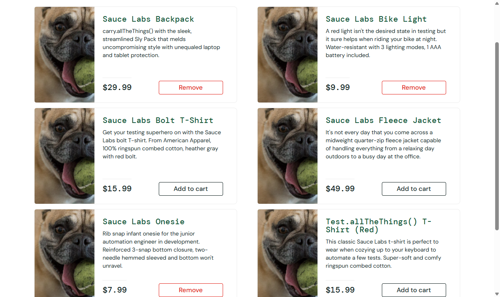

# Defect Reports

Every defect below was **observed** while building and running this project on 2026-10-21.
Each one lists how it was found and how to reproduce it. Nothing is hypothetical.

> Context: SauceDemo's `problem_user` / `error_user` and Restful Booker are practice systems with
> intentionally planted bugs. They are reported here in the same format used for production
> defects. BUG-WEB-01 and BUG-API-07 affect the normal user path.

## Summary

| ID | Title | System | Severity | Priority | Detected by |
|---|---|---|---|---|---|
| [BUG-WEB-01](#bug-web-01) | Checkout item total shows floating-point artifacts | SauceDemo (`standard_user`) | Minor | High | Exploratory probe → automated test |
| [BUG-WEB-02](#bug-web-02) | All product images show the same placeholder | SauceDemo (`problem_user`) | Major | Medium | Exploratory probe |
| [BUG-WEB-03](#bug-web-03) | Sorting has no effect | SauceDemo (`problem_user`) | Major | Medium | Exploratory probe |
| [BUG-WEB-04](#bug-web-04) | Three products cannot be added to the cart | SauceDemo (`problem_user`, `error_user`) | Critical | High | Exploratory probe |
| [BUG-WEB-05](#bug-web-05) | Last Name input writes into First Name | SauceDemo (`problem_user`) | Critical | High | Exploratory probe |
| [BUG-WEB-06](#bug-web-06) | Sorting raises "Sorting is broken!" alert | SauceDemo (`error_user`) | Major | Medium | Exploratory probe |
| [BUG-WEB-07](#bug-web-07) | Last Name not accepted, validation bypassed, Finish does nothing | SauceDemo (`error_user`) | Critical | High | Exploratory probe |
| [BUG-API-01](#bug-api-01) | Bad credentials return 200 instead of 401 | Restful Booker | Major | Medium | Postman test |
| [BUG-API-02](#bug-api-02) | Missing required fields cause 500 instead of 400 | Restful Booker | Major | High | Postman test |
| [BUG-API-03](#bug-api-03) | Non-numeric `totalprice` accepted and stored as `null` | Restful Booker | Major | High | Postman test |
| [BUG-API-04](#bug-api-04) | Checkout date before checkin date is accepted | Restful Booker | Major | Medium | Postman test |
| [BUG-API-05](#bug-api-05) | Successful DELETE returns 201 Created | Restful Booker | Minor | Low | Postman test |
| [BUG-API-06](#bug-api-06) | Deleting a missing booking returns 405 instead of 404 | Restful Booker | Minor | Low | Postman test |
| [BUG-API-07](#bug-api-07) | API served over plain HTTP; credentials sent in cleartext | Restful Booker | Critical | High | Wireshark capture |

**Severity** = impact on the user/system. **Priority** = how soon it should be fixed. They are
independent: BUG-WEB-01 is cosmetic (Minor) but visible to every customer at checkout (High priority).

---

## SauceDemo (web) — https://www.saucedemo.com

Environment for all web defects: Chrome 155 (headless and headed), Selenium 4.51.0, Windows 11.
Login password for all users is the public `secret_sauce` shown on the login page.

### BUG-WEB-01

**Checkout item total shows floating-point artifacts**

| Field | Value |
|---|---|
| User | `standard_user` |
| Severity / Priority | Minor / High |
| Steps | 1. Log in. 2. Add **Sauce Labs Bike Light** ($9.99) and **Sauce Labs Fleece Jacket** ($49.99). 3. Cart → Checkout → enter any name and postal code → Continue. |
| Expected | `Item total: $59.98` |
| Actual | `Item total: $59.980000000000004` |
| Evidence | `CheckoutTest.itemTotalIsFormattedToTwoDecimals` fails with `expected [Item total: $59.98] but found [Item total: $59.980000000000004]`. Also seen with 5 items: `$113.94999999999999`. |
| Root cause (analysis) | Prices are added as IEEE-754 doubles and printed without rounding (9.99 + 49.99 = 59.980000000000004 in JavaScript). Tax and Total *are* rounded correctly. Fix: use integer cents or format with `toFixed(2)`. |
| Reproduce | `./mvnw test -Dgroups=known-defect -Dtest=CheckoutTest` |

### BUG-WEB-02

**All product images show the same placeholder**

| Field | Value |
|---|---|
| User | `problem_user` |
| Steps | Log in and view the Products page. |
| Expected | Each of the 6 products shows its own image (as for `standard_user`: 6 distinct `src` values). |
| Actual | All 6 images have the same `src`: `/assets/sl-404-Cq1a9k9X.jpg` (a dog photo). |
| Evidence |  |

### BUG-WEB-03

**Sorting has no effect**

| Field | Value |
|---|---|
| User | `problem_user` |
| Steps | Log in → choose **Name (Z to A)** in the sort dropdown. |
| Expected | First product is `Test.allTheThings() T-Shirt (Red)` (as for `standard_user`). |
| Actual | First product is still `Sauce Labs Backpack`; the list stays A→Z (visible in the BUG-WEB-02 screenshot). |

### BUG-WEB-04

**Three products cannot be added to the cart**

| Field | Value |
|---|---|
| Users | `problem_user`, `error_user` |
| Steps | Log in → click **Add to cart** on each of the 6 products. |
| Expected | Cart badge shows 6. |
| Actual | Badge shows 3. Clicking Add to cart on **Bolt T-Shirt**, **Fleece Jacket** and **Test.allTheThings() T-Shirt (Red)** does nothing. "Remove" on the inventory page also does not decrement the badge (3 → 3). |

### BUG-WEB-05

**Last Name input writes into First Name**

| Field | Value |
|---|---|
| User | `problem_user` |
| Steps | Add an item → Checkout → type `Test` in First Name, `Shopper` in Last Name, `10001` in Postal Code → Continue. |
| Expected | Fields contain `Test` / `Shopper` / `10001`; user proceeds to the overview. |
| Actual | First Name contains `r` (the last character typed into Last Name), Last Name is empty, and the error `Error: Last Name is required` blocks checkout. The user cannot complete a purchase. |

### BUG-WEB-06

**Sorting raises an error alert**

| Field | Value |
|---|---|
| User | `error_user` |
| Steps | Log in → choose **Name (Z to A)**. |
| Expected | Products re-ordered Z→A. |
| Actual | Browser alert: `Sorting is broken! This error has been reported to Backtrace.` List is not re-ordered. |

### BUG-WEB-07

**Last Name not accepted, validation bypassed, Finish does nothing**

| Field | Value |
|---|---|
| User | `error_user` |
| Steps | Add items → Checkout → type `Test` / `Shopper` / `10001` → Continue → Finish. |
| Expected | Order completes with "Thank you for your order!". |
| Actual | Last Name stays empty, yet Continue proceeds to the overview anyway (required-field validation is bypassed). Clicking **Finish** leaves the user on `checkout-step-two.html`; no confirmation is shown. |

---

## Restful Booker (API) — https://restful-booker.herokuapp.com

Environment: Newman 6.2.3 / curl, 2026-10-21. Each defect is asserted as *current behaviour* in the
Postman collection (tests tagged `[KNOWN DEFECT BUG-API-xx]`). If the API is fixed, those tests fail
and prompt an update. Docs: https://restful-booker.herokuapp.com/apidoc/index.html

### BUG-API-01

**Bad credentials return 200 instead of 401**

| Field | Value |
|---|---|
| Request | `POST /auth` with `{"username":"admin","password":"definitely-wrong"}` (also `{}`) |
| Expected | `401 Unauthorized` |
| Actual | `200 OK` with body `{"reason":"Bad credentials"}` |
| Impact | Clients that check only the status code treat a failed login as success. |

### BUG-API-02

**Missing required fields cause 500 instead of 400**

| Field | Value |
|---|---|
| Request | `POST /booking` with `{"firstname":"OnlyFirstName"}` |
| Expected | `400 Bad Request` naming the missing fields (the docs list them as required) |
| Actual | `500 Internal Server Error`, body `Internal Server Error` |
| Impact | Unvalidated input reaches the server and crashes the request; 5xx also triggers false alerts. |

### BUG-API-03

**Non-numeric `totalprice` is accepted and stored as `null`**

| Field | Value |
|---|---|
| Request | `POST /booking` with `"totalprice": "abc"` (all other fields valid) |
| Expected | `400 Bad Request` (docs: `totalprice` is a Number) |
| Actual | `200 OK`; booking created with `"totalprice": null` |
| Impact | Silent data loss: a booking without a price is persisted. |

### BUG-API-04

**Checkout date before checkin date is accepted**

| Field | Value |
|---|---|
| Request | `POST /booking` with `checkin` = run date + 33 days, `checkout` = run date + 30 days |
| Expected | `400 Bad Request` |
| Actual | `200 OK`; booking stored with reversed dates |

### BUG-API-05

**Successful DELETE returns 201 Created**

| Field | Value |
|---|---|
| Request | `DELETE /booking/{id}` with a valid `Cookie: token=...` |
| Expected | `200 OK` or `204 No Content` (RFC 9110: 201 means a resource was created) |
| Actual | `201 Created`, body `Created` |
| Note | The API docs also show 201, so this is a documented design defect rather than a regression. |

### BUG-API-06

**Deleting a missing booking returns 405 instead of 404**

| Field | Value |
|---|---|
| Request | `DELETE /booking/{id}` for an id that was just deleted, with a valid token |
| Expected | `404 Not Found` |
| Actual | `405 Method Not Allowed` |
| Impact | 405 tells the client the *method* is wrong, which sends debugging in the wrong direction. |

### BUG-API-07

**API served over plain HTTP; credentials sent in cleartext**

| Field | Value |
|---|---|
| Request | `POST http://restful-booker.herokuapp.com/auth` (note `http://`) |
| Expected | `301/308` redirect to HTTPS, or the connection refused |
| Actual | `200 OK` with a valid token. Wireshark (no decryption keys) shows the body `{"username":"admin","password":"password123"}` and the response token in cleartext (frames 103/105 of the capture). |
| Impact | Anyone on the network path can steal credentials and tokens. Fix: redirect HTTP to HTTPS and send HSTS. |
| Evidence | [network-analysis.md §3.5](network-analysis.md#35-finding-credentials-sent-over-plain-http) |

---

## Defect report template

| Field | Value |
|---|---|
| ID | |
| Title | |
| Environment | (app version/URL, browser/device, OS, date) |
| Severity / Priority | |
| Preconditions | |
| Steps to reproduce | |
| Expected result | |
| Actual result | |
| Evidence | (screenshot, log, test name, capture frame) |
| Status | |
